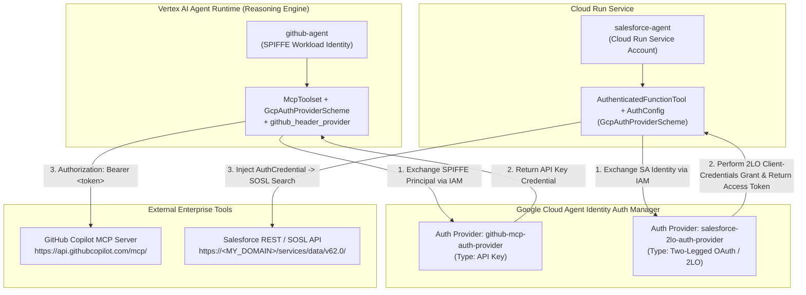

# Agent Identity Foundations & Auth Manager Runbook (APEX Lab 2)

This repository contains the refactored multi-agent implementation and step-by-step operational runbook for **Google Cloud Agent Identity & Auth Manager** with the **Agent Development Kit (ADK)**.

---

## Architecture Overview

Instead of baking static API keys or OAuth client secrets into agent `.env` files or container images, both specialist agents resolve credentials **just-in-time at tool invocation** through **Google Cloud Agent Identity Auth Manager** (`agentidentity.googleapis.com`):



### Comparison of the Two Delivery Patterns

| Aspect | GitHub Agent (`github-agent`) | Salesforce Agent (`salesforce-agent`) |
| :--- | :--- | :--- |
| **Hosting Platform** | Vertex AI Agent Runtime (Reasoning Engine) | Google Cloud Run |
| **Workload Identity** | Federated SPIFFE Principal (`principal://agents.global.org-...`) | Cloud Run Service Account (`serviceAccount:...`) |
| **Auth Provider Type** | **API Key** (`--api-key`) | **2-Legged OAuth (2LO)** (`--two-legged-oauth-*`) |
| **Auth Provider Name** | `github-mcp-auth-provider` | `salesforce-2lo-auth-provider` |
| **ADK Tool Type** | Remote MCP Server (`McpToolset`) | Python Function Tool (`AuthenticatedFunctionTool`) |
| **How Token Reaches Tool** | `header_provider` reads `auth_config` and attaches `Authorization: Bearer <token>` header | ADK injects `credential: AuthCredential` parameter directly into `search_salesforce()` |

---

## Repository Structure

```text
.
├── README.md                          # Architecture overview & quick reference
├── docs/
│   └── RUNBOOK.md                     # Detailed step-by-step runbook (Tasks 1–5)
└── agents/
    ├── github-agent/                  # Refactored GitHub MCP Agent (Vertex AI Agent Runtime)
    │   ├── .env.example
    │   ├── Dockerfile
    │   ├── deploy_with_identity.sh
    │   └── agent/
    │       ├── agent.py               # Uses GcpAuthProvider, GcpAuthProviderScheme & header_provider
    │       ├── main.py                # FastAPI A2A server with dynamic AgentCardBuilder
    │       └── requirements.txt
    └── salesforce-agent/              # Refactored Salesforce SOSL Agent (Cloud Run)
        ├── .env.example
        ├── pyproject.toml             # Includes google-adk[gcp,agent-identity]
        └── app/
            ├── agent.py               # Credential-free SalesforceClient + Memory Bank callback
            ├── salesforce_client.py   # Derives REST instance_url from My Domain; no authenticate()
            └── tools.py               # Uses AuthenticatedFunctionTool + injected AuthCredential
```

---

## Summary of Completed Lab Tasks

1. **[Task 1: Prepare Environment for Agent Identity](./docs/RUNBOOK.md#task-1-prepare-your-environment-for-agent-identity)**
   - Configured project variables (`PROJECT_ID`, `PROJECT_NUMBER`, `ORGANIZATION_ID`, `LOCATION=us-central1`, `REGION=us-central1`).
   - Enabled `iam.googleapis.com`, `agentidentity.googleapis.com`, `aiplatform.googleapis.com`, `agentidentitycredentials.googleapis.com`, `iamcredentials.googleapis.com`, and `sts.googleapis.com`.
   - Installed `google-agents-cli==1.0.0` and staged baseline agent code.
2. **[Task 2: Create the GitHub API-Key Auth Provider](./docs/RUNBOOK.md#task-2-create-the-github-api-key-auth-provider)**
   - Created `github-mcp-auth-provider` in `us-central1` storing the GitHub PAT inside Auth Manager.
3. **[Task 3: Move the GitHub Agent onto the Auth Provider](./docs/RUNBOOK.md#task-3-move-the-github-agent-onto-the-auth-provider)**
   - Refactored [`agents/github-agent/agent/agent.py`](./agents/github-agent/agent/agent.py) to register `GcpAuthProvider()`, configure `GcpAuthProviderScheme`, and attach the resolved token via `github_header_provider`.
   - Provisioned the Reasoning Engine with `AGENT_IDENTITY` and deployed code via [`deploy_with_identity.sh`](./agents/github-agent/deploy_with_identity.sh).
   - Bound `roles/agentidentity.user` on `github-mcp-auth-provider` to the agent's SPIFFE principal and lab user.
4. **[Task 4: Create the Salesforce 2LO Auth Provider](./docs/RUNBOOK.md#task-4-create-the-salesforce-2lo-auth-provider)**
   - Created `salesforce-2lo-auth-provider` in `us-central1` configured with the Salesforce Connected App consumer key, consumer secret, and OAuth2 token URL (`https://<SF_DOMAIN>/services/oauth2/token`).
5. **[Task 5: Update the Salesforce Agent to Use the Auth Provider](./docs/RUNBOOK.md#task-5-update-the-salesforce-agent-to-use-the-auth-provider)**
   - Refactored [`agents/salesforce-agent/app/tools.py`](./agents/salesforce-agent/app/tools.py), [`agents/salesforce-agent/app/agent.py`](./agents/salesforce-agent/app/agent.py), and [`agents/salesforce-agent/app/salesforce_client.py`](./agents/salesforce-agent/app/salesforce_client.py) to use `AuthenticatedFunctionTool` and injected `AuthCredential`.
   - Added `google-adk[gcp,agent-identity]` to [`pyproject.toml`](./agents/salesforce-agent/pyproject.toml), refreshed `uv.lock`, deployed to Cloud Run, granted `roles/agentidentity.user` to the Cloud Run service account, disabled IAP (`--no-iap`), and verified A2A search queries.

See [**`docs/RUNBOOK.md`**](./docs/RUNBOOK.md) for the complete command-by-command execution log and verification steps.
